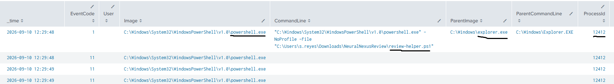
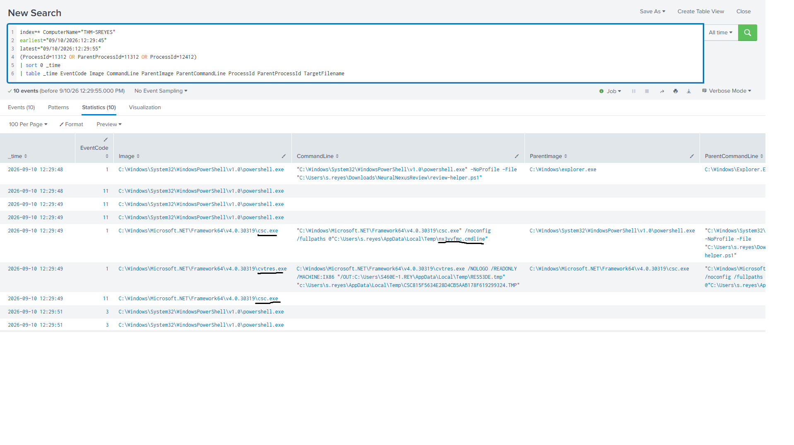
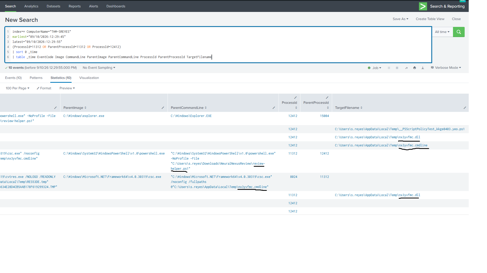
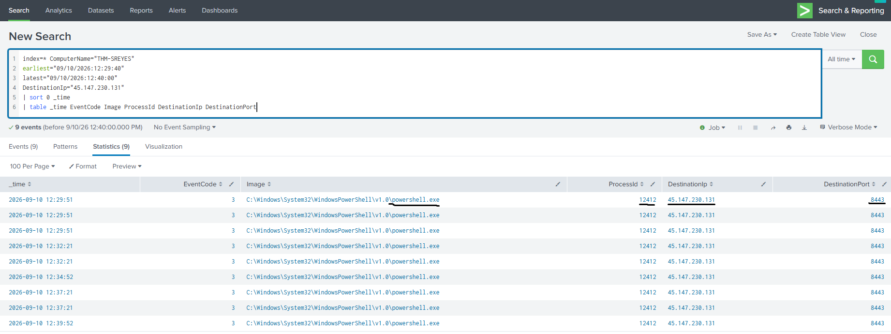
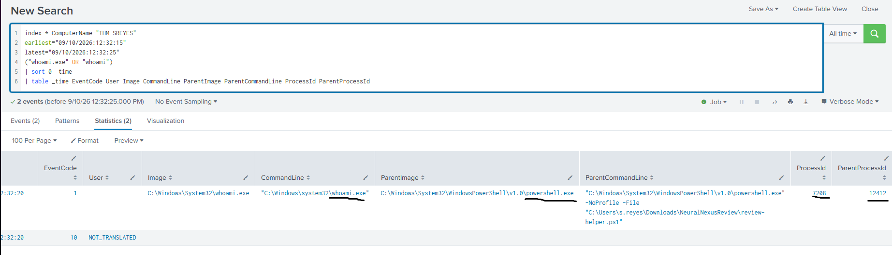
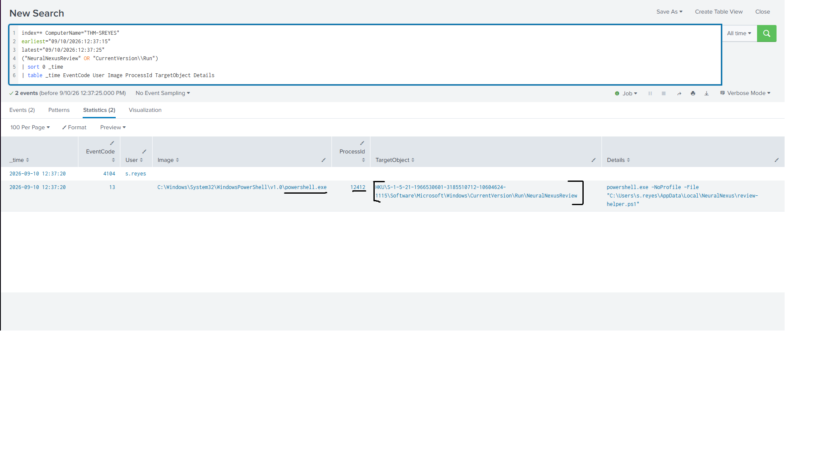
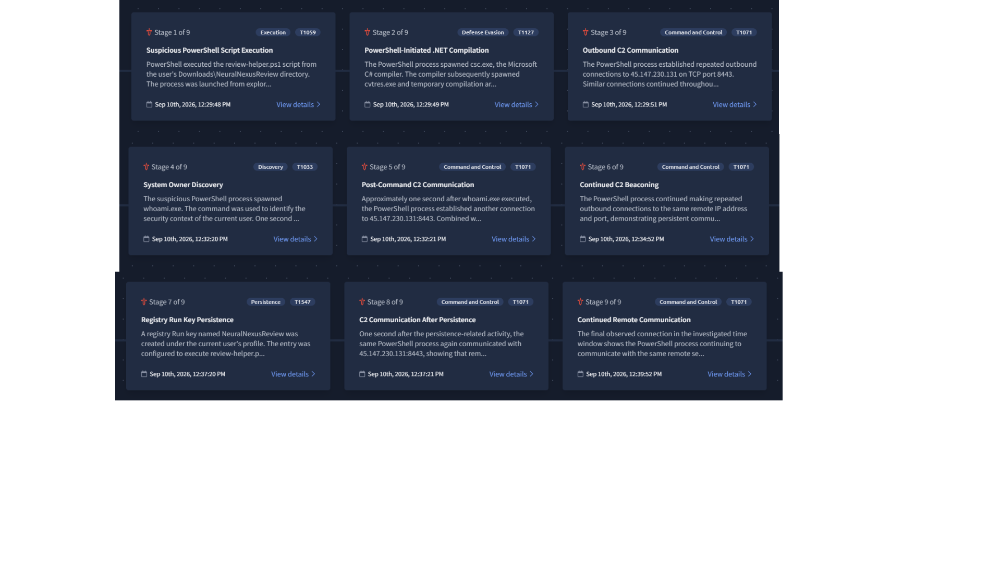

# Quiet As The Grave

> TryHackMe Threat Hunting Sim Scenario

## Overview

In this scenario, I investigated suspicious activity in a Windows environment using Splunk.

Unlike a normal alert investigation, the scenario started with a threat hunting hypothesis. My goal was to search through the available telemetry, identify suspicious activity, connect related events, and reconstruct the attack chain.

During the investigation, I identified suspicious PowerShell execution, .NET compilation, repeated C2 communication, user discovery, and registry-based persistence on the `THM-SREYES` host.

## Tools Used

- Splunk
- Windows Event Logs
- Sysmon telemetry
- MITRE ATT&CK

## Investigation

### 1. Initial PowerShell Execution

I started by reviewing process creation events around the suspected time of compromise.

I found `powershell.exe` running the following script:

```text
C:\Users\s.reyes\Downloads\NeuralNexusReview\review-helper.ps1
```

The parent process was `explorer.exe`, which indicates that the PowerShell process was started from the user's interactive session.

The PowerShell process had PID `12412`. I used this PID later to correlate additional activity with the same process.



This gave me the first suspicious process chain:

```text
explorer.exe
└── powershell.exe
    └── review-helper.ps1
```

---

### 2. Suspicious .NET Compilation

Shortly after the PowerShell execution, I found `csc.exe`, the Microsoft C# compiler, being started by the same PowerShell process.

The process relationship showed:

```text
powershell.exe (PID 12412)
└── csc.exe (PID 11312)
    └── cvtres.exe
```



The activity also created temporary compilation artifacts, including:

```text
C:\Users\s.reyes\AppData\Local\Temp\nx3yvfmc.dll
C:\Users\s.reyes\AppData\Local\Temp\nx3yvfmc.cmdline
```



The use of a legitimate compiler inside this suspicious process chain was important because trusted developer utilities can be abused to execute or build malicious code while blending in with legitimate system activity.

---

### 3. Command and Control Communication

Next, I searched for network activity associated with the suspicious PowerShell process.

I identified repeated outbound connections to:

```text
45.147.230.131:8443
```

The connections were generated by:

```text
C:\Windows\System32\WindowsPowerShell\v1.0\powershell.exe
PID: 12412
```



The first observed connection occurred at approximately `12:29:51`, only a few seconds after the initial script execution.

Additional connections continued during the investigation, which suggested an active C2 channel rather than a single network request.

**C2 indicator:**

```text
IP:   45.147.230.131
Port: 8443
```

---

### 4. User Discovery

At `12:32:20`, I found the execution of:

```text
C:\Windows\System32\whoami.exe
```

The important part was its parent process.

`whoami.exe` had:

```text
ProcessId:       7208
ParentProcessId: 12412
ParentImage:     powershell.exe
```



The parent PID matched the suspicious PowerShell process identified earlier.

This allowed me to connect the discovery command directly to the existing attack chain instead of treating it as an unrelated `whoami.exe` execution.

Shortly after this command, communication with the same C2 IP continued.

---

### 5. Registry Persistence

Later in the timeline, I found registry activity associated with the same PowerShell process.

A new value named:

```text
NeuralNexusReview
```

was created under the user's Windows Run key:

```text
HKCU\Software\Microsoft\Windows\CurrentVersion\Run\NeuralNexusReview
```

The value was configured to execute:

```text
powershell.exe -NoProfile -File "C:\Users\s.reyes\AppData\Local\NeuralNexus\review-helper.ps1"
```



This would allow the PowerShell script to execute again when the user logs on.

The same PowerShell PID `12412` was associated with this activity, providing another connection between the persistence mechanism and the original suspicious process.

---

## Attack Timeline

| Time | Activity |
|---|---|
| 12:29:48 | `powershell.exe` executes `review-helper.ps1` |
| 12:29:49 | PowerShell launches `csc.exe` |
| 12:29:49 | .NET compilation artifacts are created |
| 12:29:51 | First observed connection to `45.147.230.131:8443` |
| 12:32:20 | `whoami.exe` is executed from PowerShell |
| 12:32:21 | Communication with the C2 infrastructure continues |
| 12:37:20 | `NeuralNexusReview` Run key is created |
| 12:37:21 | C2 communication continues after persistence |
| 12:39:52 | Additional C2 communication is observed |

## Reconstructed Attack Chain

After correlating the process, network, and registry events, I reconstructed the attack chain in the scenario.



The main activity can be summarized as:

```text
User session
    │
    ▼
explorer.exe
    │
    ▼
powershell.exe
    │
    ├── review-helper.ps1
    │
    ├── csc.exe
    │     └── cvtres.exe
    │
    ├── C2 → 45.147.230.131:8443
    │
    ├── whoami.exe
    │
    └── Registry Run Key
          └── review-helper.ps1
```

## MITRE ATT&CK Mapping

| Tactic | Technique | Observed Activity |
|---|---|---|
| Execution | Command and Scripting Interpreter | PowerShell executed `review-helper.ps1` |
| Defense Evasion | Trusted Developer Utilities | `csc.exe` was used during the suspicious execution chain |
| Command and Control | Application Layer Protocol | Repeated communication with `45.147.230.131:8443` |
| Discovery | System Owner/User Discovery | `whoami.exe` execution |
| Persistence | Boot or Logon Autostart Execution | `NeuralNexusReview` Run key |

## Indicators of Compromise

### Network

```text
45.147.230.131:8443
```

### Files

```text
C:\Users\s.reyes\Downloads\NeuralNexusReview\review-helper.ps1
C:\Users\s.reyes\AppData\Local\NeuralNexus\review-helper.ps1
C:\Users\s.reyes\AppData\Local\Temp\nx3yvfmc.dll
C:\Users\s.reyes\AppData\Local\Temp\nx3yvfmc.cmdline
```

### Registry

```text
HKCU\Software\Microsoft\Windows\CurrentVersion\Run\NeuralNexusReview
```

### Host

```text
THM-SREYES
```

## Assessment

The investigation confirmed suspicious activity on `THM-SREYES`.

The evidence showed PowerShell-based execution followed by .NET compilation, repeated communication with an external IP, user discovery, and the creation of a registry persistence mechanism.

The repeated use of PID `12412` helped correlate several events and showed that they belonged to the same PowerShell process.

The available telemetry was enough to confirm the malicious activity and persistence on the endpoint. However, I did not find enough evidence to confirm data exfiltration or lateral movement to another system.

## What I Learned

This scenario gave me more practice with threat hunting in Splunk without starting from a confirmed security alert.

The most useful part was learning to connect separate events instead of investigating each event individually. Process IDs, parent process IDs, timestamps, command lines, network connections, and registry events helped reconstruct the activity step by step.

I also got more practice with:

- tracking parent-child process relationships;
- using PIDs to correlate events;
- identifying suspicious use of legitimate Windows and .NET tools;
- investigating Sysmon network events;
- finding registry-based persistence;
- mapping observed activity to MITRE ATT&CK;
- building an attack timeline from SIEM telemetry.

The main lesson from this investigation was that a single event often does not provide enough context. Correlating multiple sources of telemetry made the attack chain much clearer.

## Conclusion

The investigation identified a PowerShell-based intrusion on `THM-SREYES` involving suspicious .NET compilation, C2 communication, user discovery, and registry persistence.

By following the PowerShell process and correlating process, network, and registry events, I was able to reconstruct the main stages of the attack and confirm the original threat hunting hypothesis.

At the same time, I kept the conclusions limited to what the available evidence could support. While C2 activity was confirmed, the telemetry did not provide enough evidence to confirm data exfiltration or lateral movement.
