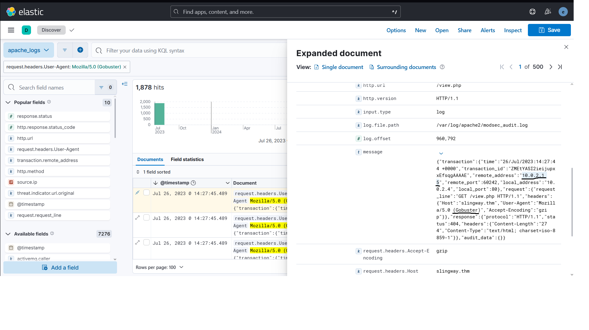
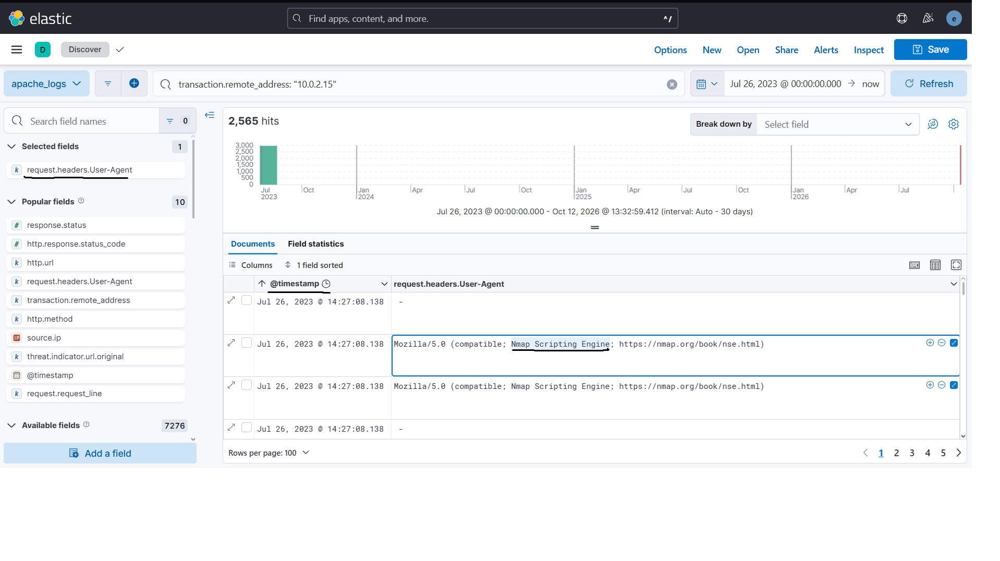
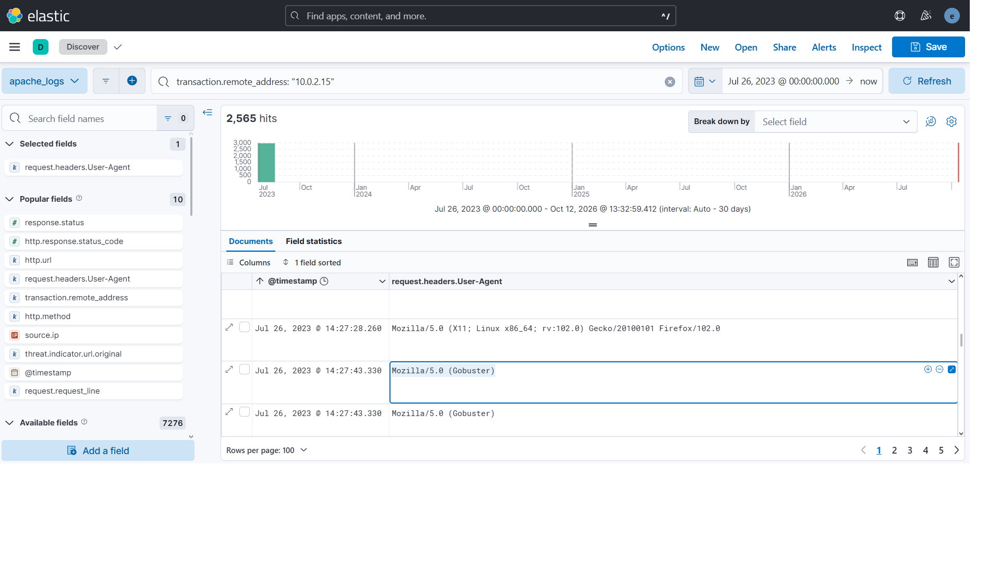
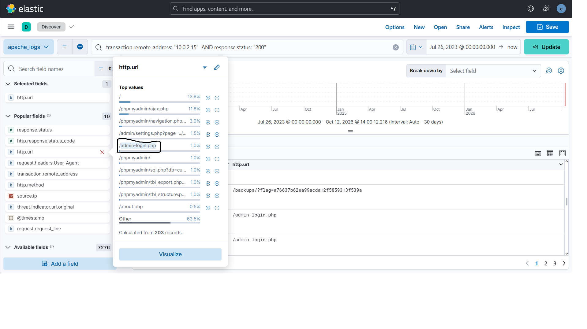
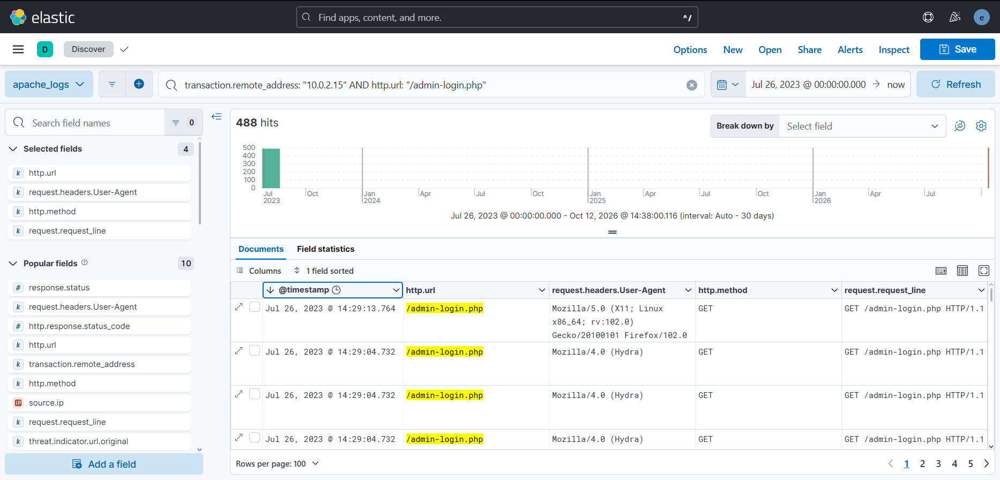
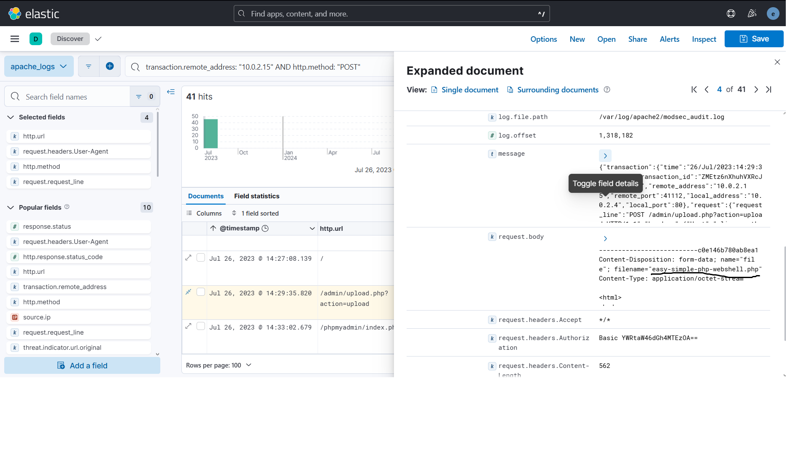
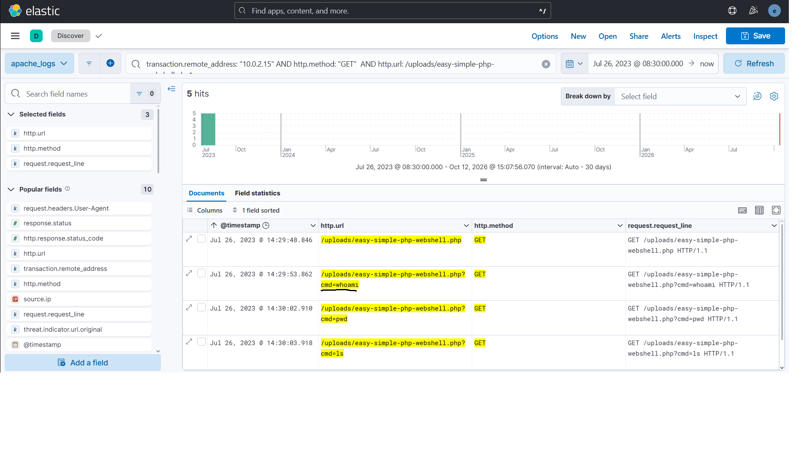
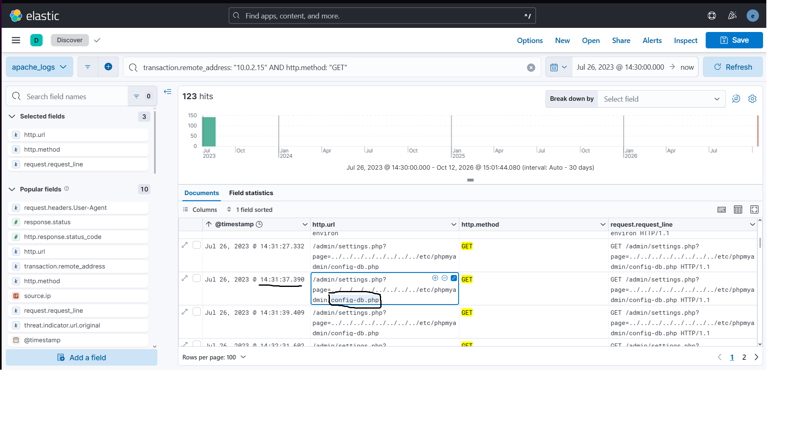
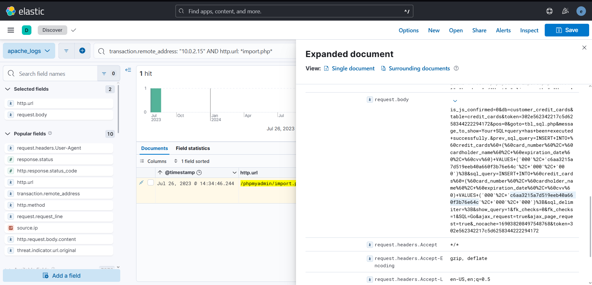
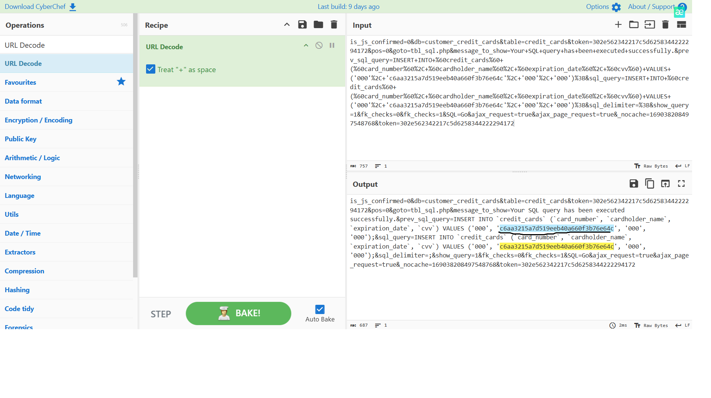

# Slingshot - Web Server Attack Investigation

## Overview

This investigation focuses on analyzing Apache web server logs in Elastic/Kibana and reconstructing the attacker's activity.

During the investigation, I identified the attacker, analyzed reconnaissance and directory enumeration activity, investigated a brute-force attack against an admin panel, and followed the attack after the web server was compromised.

The investigation also included web shell activity, Local File Inclusion (LFI), access to phpMyAdmin, and database manipulation.

## Tools Used

- Elastic / Kibana
- KQL
- Apache web logs
- CyberChef

## Attack Summary

The investigation showed the following attack chain:

```text
Reconnaissance
      ↓
Directory Enumeration
      ↓
Admin Panel Discovery
      ↓
Brute Force Attack
      ↓
Successful Authentication
      ↓
Web Shell Upload
      ↓
Command Execution
      ↓
Local File Inclusion
      ↓
Database Access
      ↓
Database Manipulation
```

---

## 1. Attacker Identification

I started by reviewing the Apache logs and looking at suspicious HTTP requests.

The attacker was identified by the following IP address:

```text
10.0.2.15
```

I used this IP address during the rest of the investigation to filter the attacker's activity.



---

## 2. Reconnaissance

After filtering the events related to the attacker, I checked the User-Agent values.

One of the first suspicious User-Agents was:

```text
Mozilla/5.0 (compatible; Nmap Scripting Engine; https://nmap.org/book/nse.html)
```

This showed that the attacker used the **Nmap Scripting Engine** to scan the web server.



---

## 3. Directory Enumeration

Shortly after the Nmap activity, I found another suspicious User-Agent:

```text
Mozilla/5.0 (Gobuster)
```

Gobuster is commonly used to discover hidden files and directories on web servers.



The attacker generated a large number of requests during this activity.

The enumeration resulted in:

```text
1867 HTTP 404 responses
```

One of the discovered locations also contained the following flag:

```text
a76637b62ea99acda12f5859313f539a
```

The attacker also discovered the admin login page:

```text
/admin-login.php
```



---

## 4. Brute Force Attack

After discovering the admin login page, the attacker started trying credentials against it.

The requests contained the following User-Agent:

```text
Mozilla/4.0 (Hydra)
```

This indicated that **Hydra** was being used for the brute-force attack.



The attacker eventually found valid credentials:

```text
admin:thx1138
```

This allowed access to the admin panel.

---

## 5. Web Shell Upload

After gaining access to the admin panel, the attacker uploaded a PHP web shell through:

```text
/admin/upload.php
```

The uploaded file was:

```text
easy-simple-php-webshell.php
```

The upload request could be identified inside the HTTP request body.



A flag was also included inside the uploaded file:

```text
THM{ecb012e53a58818cbd17a924769ec447}
```

The successful upload gave the attacker a way to execute commands on the web server.

---

## 6. Web Shell Command Execution

I searched for requests to the uploaded web shell:

```text
/uploads/easy-simple-php-webshell.php
```

The attacker executed commands through the `cmd` parameter.

The first command was:

```text
whoami
```

Additional commands included:

```text
pwd
ls
```



This confirmed that the attacker achieved command execution on the compromised web server.

---

## 7. Local File Inclusion

After gaining command execution, the attacker continued exploring the server.

I found requests to the settings page containing directory traversal sequences.

The attacker used Local File Inclusion (LFI) to access:

```text
config-db.php
```

The request contained a path similar to:

```text
/admin/settings.php?page=../../../../../../etc/phpmyadmin/config-db.php
```



This file contained database configuration information that could be used to access phpMyAdmin.

---

## 8. Database Manipulation

After obtaining the database credentials, the attacker accessed phpMyAdmin.

The database involved in the attack was:

```text
customer_credit_cards
```

I then found suspicious activity related to:

```text
/phpmyadmin/import.php
```

The HTTP request body contained an encoded SQL query.



The request body was URL encoded, so I copied the value into CyberChef and used:

```text
URL Decode
```

After decoding the request, the SQL query became readable.



The attacker inserted the following value into the database:

```text
c6aa3215a7d519eeb40a660f3b76e64c
```

This confirmed that the attacker was able to modify data inside the compromised database.

---

## Attack Timeline

| Stage | Evidence |
|---|---|
| Reconnaissance | Nmap Scripting Engine User-Agent |
| Directory Enumeration | Gobuster User-Agent and large number of HTTP requests |
| Admin Discovery | `/admin-login.php` |
| Brute Force | Hydra User-Agent |
| Authentication | Valid `admin` credentials discovered |
| File Upload | PHP web shell uploaded through `/admin/upload.php` |
| Command Execution | `whoami`, `pwd`, and `ls` executed through the web shell |
| Local File Inclusion | `config-db.php` accessed using directory traversal |
| Database Access | `customer_credit_cards` accessed through phpMyAdmin |
| Database Manipulation | SQL query submitted through `import.php` |

---

## Useful KQL Queries

### Filter attacker activity

```kql
transaction.remote_address: "10.0.2.15"
```

### Search for admin login activity

```kql
transaction.remote_address: "10.0.2.15" AND http.url: "/admin-login.php"
```

### Search GET requests

```kql
transaction.remote_address: "10.0.2.15" AND http.method: "GET"
```

### Search POST requests

```kql
transaction.remote_address: "10.0.2.15" AND http.method: "POST"
```

### Search for the phpMyAdmin import request

```kql
transaction.remote_address: "10.0.2.15" AND http.url: *import.php*
```

These filters helped reduce the number of events and follow the attacker's activity step by step.

---

## What I Learned

During this investigation I practiced:

- filtering Apache logs in Elastic/Kibana;
- using KQL to investigate a specific IP address;
- analyzing HTTP methods, URLs, request bodies, and User-Agent values;
- identifying reconnaissance tools from HTTP logs;
- recognizing directory enumeration activity;
- identifying brute-force activity;
- investigating a malicious file upload;
- tracking commands executed through a web shell;
- identifying Local File Inclusion and directory traversal;
- investigating phpMyAdmin activity;
- decoding URL-encoded HTTP request data with CyberChef;
- reconstructing an attack chain from web server logs.

One important lesson from this investigation was that a single HTTP request does not always explain what happened.

By following the same source IP, timestamps, URLs, HTTP methods, User-Agent values, and request bodies, I was able to connect separate events and reconstruct the attacker's actions.

---

## Conclusion

The investigation showed a complete web server compromise.

The attacker first performed reconnaissance and directory enumeration, discovered the admin panel, and used Hydra to obtain valid credentials.

After accessing the admin panel, the attacker uploaded a PHP web shell and used it to execute commands on the server.

The attacker then used Local File Inclusion to access database configuration information, accessed phpMyAdmin, and finally modified data inside the database.

This investigation gave me practical experience with using Elastic/Kibana to follow an attack across multiple stages and reconstruct an attack timeline from Apache web logs.

---

## Lab Source

TryHackMe - **Slingshot**  
SOC Level 2 → Advanced Elastic
